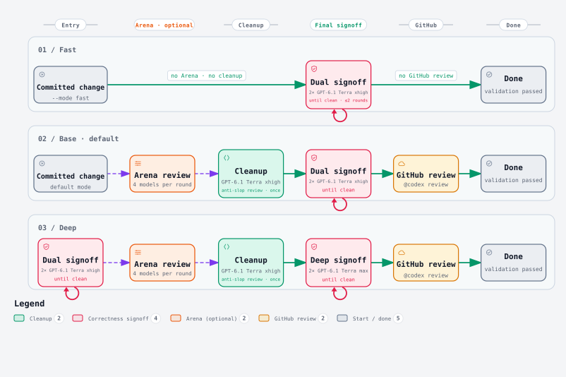

# Review Suite

Review Suite gets a branch merge-ready: It runs local code review,
tracks fixes and validation and also reviews for slop

<picture>
  <source media="(prefers-color-scheme: dark)" srcset="docs/review-workflow-dark.svg">
  
</picture>

## Install

```powershell
npx skills add JJLiebig/review-suite
```

Or install from the Codex marketplace:

```powershell
codex plugin marketplace add JJLiebig/review-suite
codex plugin add review-suite@review-suite
```

Requires Python 3.14.7+, Git, Node.js (for `npx`) and an authenticated Codex CLI. GitHub review also
needs an authenticated `gh` CLI.

## Use

Tell your agent:

> Use review suite to get the PR merge ready

The agent picks the lane from the change's risk.

Note, if reviews take too long, there is a circuit breaker.

### Resolve GitHub findings

GitHub review output includes a `resolve` command. Use the inline finding's URL
with either `--fixed <short-sha>` or `--reason "<why it is not relevant>"`:

```sh
python <plugin-root>/scripts/review_github.py resolve <comment-url> --fixed abc1234
python <plugin-root>/scripts/review_github.py resolve <comment-url> --reason "The caller already handles this case."
```

This replies “Fixed in abc1234.” or “Not relevant: …” and resolves that thread.
Push fixes first; the command checks that the commit is on the remote PR branch.
Retry the same command after a failure; it reuses an existing matching reply.
Review and validation results are recorded separately, as before.

## Settings

Override the [shipped defaults](plugins/review-suite/default_settings.toml) in
`~/.agents/state/review-suite/settings.toml`:

```toml
[jobs.plan]
reasoning = "high"
```

Jobs are `plan`, `deslop`, `followup`, `base_signoff` and `deep_signoff`; each
can set `model`, `reasoning` and `service_tier`.

## Arena

The arena pits whichever models you want against each other.
This way you can benchmark the models that fit you best.
A provider is missing? Fork it yourself, they are very easy to add! Default-off.

## Development

Run `just setup` once per clone, then `just check`.
